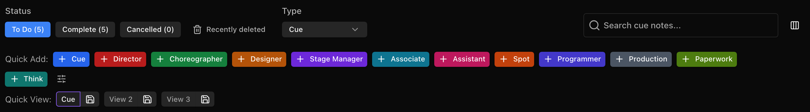

# Setting up your Workflow

Base projects in The Notes List are provided with generic "Quick Add" options so you can jump right in to taking notes. These are fully customizable at any time.&#x20;

<figure><figcaption></figcaption></figure>

### Modules Tab

The main layout of TheNotesList is split into two main windows. The modules tab and the note-taking tab. The modules tab can be found on the left hand side of your screen as seen here:

<figure><figcaption></figcaption></figure>

The modules table gives you quick access to any modules you have made, the settings page, and an option to link back out to the homepage. This tab also has a toggle to enable **Designer Mode** which we will go into further detail later in the guide.

### Note-Taking Window

The Note-Taking Window is where the work happens. This window has all of your quick add buttons, a searchable index of your created notes, along with tabs for your integrations and exports (more to come on those later).&#x20;

So, You've set up your modules along with your desired quick adds and now it is time to take notes.&#x20;

<figure><figcaption></figcaption></figure>

The columns in the note-taking window are customizable as well. To edit these columns, select the icon just to the right of the search window.&#x20;

<figure><figcaption></figcaption></figure>

A dialogue box will appear with options to hide and unhide to fit your preferences. These include:

* Priority
* Actions
* Type
* Cue #
* Note
* Scenery Needs
* Script Page
* Cue Label (Cue Notes only): the cue's label, such as "Blackout", for that exact cue number. It comes from the lighting desk when a paired Companion station reads an ETC Eos cue list, otherwise from a linked Cuelist project. The desk's label wins when both have one, and hovering the cell shows where it came from. With no label for that cue number the cell shows "-".
* User identifiers for Completed, Reviewed, or Cancelled Notes.

<figure><figcaption></figcaption></figure>

Your column setup is saved to your account, so it follows you to any computer you sign in on. That covers which columns show, their order and width, frozen columns, and sort. On a shared computer each person keeps their own. **Reset** in the columns dialogue resets your other computers too. The demo pages keep their own separate layout.

### Choosing your Quick Add buttons

To keep a note type active but remove its Quick Add button, click the small sliders icon after the last Quick Add button and untick that type. Every type stays available everywhere else, including the Type filter and the note dialogue. This only changes your own buttons on that show's notes page, and it follows your account.

### Quick View

Quick View gives you three buttons that each save a setup of the page, so you can get back to it with one click. A view saves the status tab, Type filter, sort and columns. It doesn't save anything typed in the search box.

<figure><figcaption></figcaption></figure>

**To save a view:** set up the page the way you want it, click the save icon next to a button, type a name of up to 20 characters, and select **Save view**. Clicking a button that has nothing saved opens the same box. To replace a saved view, click its save icon and save again.

**To use a view:** click its button. The button lights up and the page changes to match. Click the lit button again to go back to what you had before. Going back doesn't survive a page reload.

A dot on a lit button means you've changed something since the view was saved. If a view uses a note type or sort column that is no longer available on the show, the rest of the view still applies and a message tells you what was skipped.

Views are saved to your account, separately for each show and notes page. They're on Cue, Work, Electrician and Production Notes in the standard desktop layout, not in Designer Mode, on a phone, or on the Work + Electrician page. You can use them even if your account can't add notes.

Column layouts are shared across your shows. Recalling a view on one show also changes the columns and sort on that notes page in your other shows.
