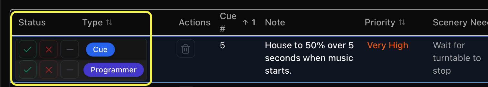
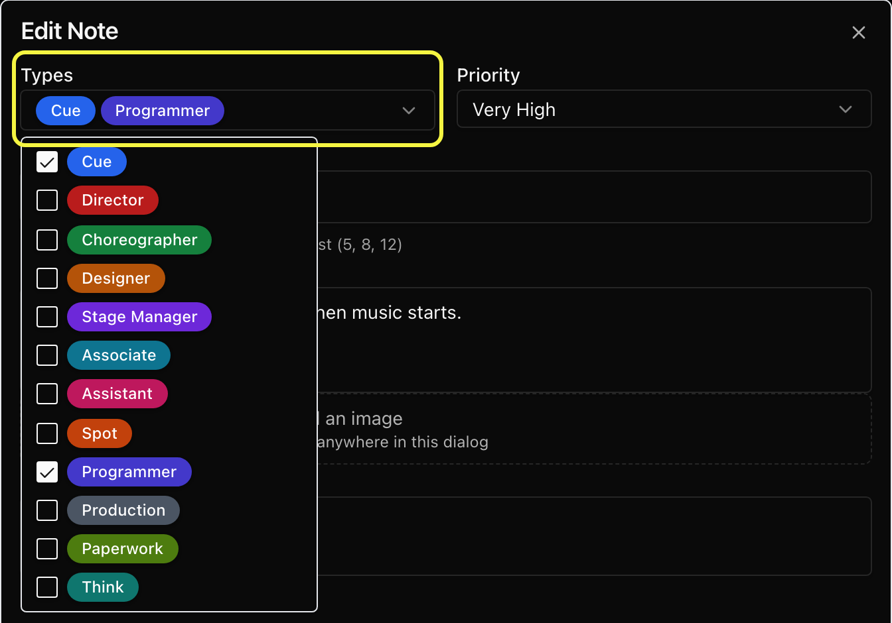

# Taking Notes

Let's take our first note. For this example we will be operating in the **Cue Notes** module but we will explore the other modules shortly.&#x20;

To add a note you can either select the **\[+ Add Cue Note]** button in the top right of the page or select any of the Quick Add options you have.&#x20;

<figure><figcaption></figcaption></figure>

For this example, let's add a note for the Stage Manager that we'd actually like to call Cue 65 a little earlier.&#x20;



### Select your Quick Add

For this example, we're selecting **\[+ Stage Manager]**


NOTE: Quick Adds automatically assign the note type but you can also assign/change this in the note window.


<figure><figcaption></figcaption></figure>

After you select your quick add, a window will appear where you can input your note.&#x20;



### Create your note

In this dialogue box you can:&#x20;

* Choose the note's types (see **Notes with more than one type** below)
* Set the priority level
* Enter a corresponding cue number
* Input the note content
* Attach an image
* List any scenic needs that pertain to this note.&#x20;

If your script is synced, you will see the bottom of the box populate as well. (More on integrations and exports later.)

<figure><figcaption></figcaption></figure>

Select **Create Note** to input the note and go back to the main window. You will see your note populated in the list. The Notes List automatically populates the note row with a color coordinated icon from your quick add selection to see different note types at a glance.

<figure><figcaption></figcaption></figure>

Once the note is created, all team members will be able to view it live. Each type on the note has its own buttons in the **Status** column:

* The green check marks that type complete.
* The red **X** marks that type cancelled.
* The dash removes that type from the note. It only appears when the note has more than one type.

The trash icon at the right end of the row deletes the whole note, with all of its types. It asks you to confirm first, then the note disappears for everyone on the show.

<figure><figcaption></figcaption></figure>

You are also able to view completed and cancelled notes by clicking the tabs in the **Status** area above the quick adds.

Deleted notes are in **Recently deleted**, next to the status tabs, for 30 days. It shows who deleted each note and when. Anyone on the show can see the list; anyone who can edit notes can **Restore** a note from it. After 30 days a deleted note is removed from the show.

A note with more than one type is listed under every tab that one of its types is in, and shows only those types there.

<figure><figcaption></figcaption></figure>




### Sort your notes.

All columns in the note-taking window are sortable by clicking the column title. In this example we've sorted notes using the priority column from highest to lowest. All priorities have the ability to be renamed, recolored, and reordered based on your production needs.

The Notes List remembers your last two sorts, the way a spreadsheet does. Click **Priority**, then click **Type**: notes are grouped by type, and within each type they stay in priority order. The column titles show a small **1** and **2** so you can see which sort comes first. Click a title again to flip between ascending and descending, or click the column marked **2** to make it the main sort. A date column sorts by day when another sort comes after it, so **When Created**, then **Cue #** lists each day's notes in cue order.

<figure><figcaption></figcaption></figure>



### Notes with more than one type

One note can need several kinds of work, for example a cue change that also needs the programmer. Instead of writing the note twice, give it more than one type.

In the note window, open **Types** and tick every type the note needs. The first type is the one the quick add picked. Select **Create Note** or **Update Note** to save.

<figure><figcaption></figcaption></figure>

Each type then gets its own line in the list, and each line is finished on its own: the programmer can mark their part complete while the cue part stays open. Click a type's colored label in the list to change it to a different type.

